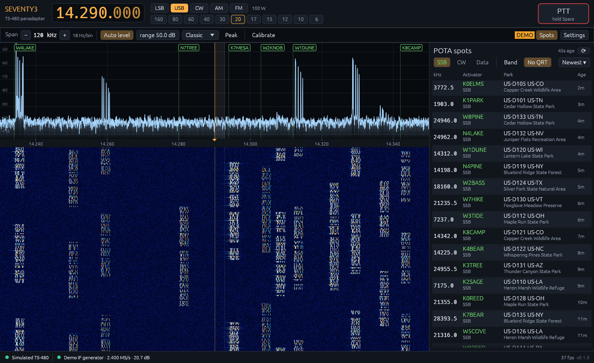

# Seventy3

A panadapter, waterfall and CAT controller for the **Kenwood TS-480**, built
for working POTA. An RTL-SDR tapped onto the rig's **73.095 MHz first IF**
shows the band around the dial; the rig's COM port does the tuning, mode
changes and PTT. The TS-480 still does all the receiving and transmitting.
Seventy3 shows you the band and steers the radio.



*Demo mode: simulated rig and band, so you can try it without hardware.*

**New to Seventy3?** The [Quick Start Guide](docs/Seventy3-Quick-Start.pdf)
(PDF, 5 pages) walks through setup step by step, with an everyday-use
reference and troubleshooting. It's ready to print or share, and it's also
attached to every [release](https://github.com/KK4ODA/Seventy3/releases/latest).

## What it does

- **Panadapter and waterfall centred on the dial.** Zoom from about 1.6 MHz
  down to 30 kHz (18 Hz resolution) by decimating the IF in software.
- **The waterfall stays aligned to RF as you tune.** Each line remembers the
  frequency it was captured at, so signals don't jump sideways when you QSY.
- **Click to tune.** For SSB a click puts the clicked signal in the middle of
  the passband (USB above the dial, LSB below). You can also drag the band,
  use the mouse wheel, or scroll over a digit of the frequency readout.
- **POTA spots** from `api.pota.app`, listed and drawn on the panadapter.
  Click either one to tune to the spot, mode included.
- **Transmit from the app.** Hold Space or click PTT; Esc always unkeys. A
  transmit timeout (3 minutes by default) unkeys a stuck PTT, and quitting or
  crashing sends `RX;` before the port closes. While transmitting, the
  waterfall pauses so your own signal on the IF tap doesn't smear the history.
- **Calibration** for the RTL-SDR's crystal error and the rig's offsets: tune
  to a known carrier (WWV, CHU) and click it.
- **Band memory**, DSP filter passband overlay, auto-levelling colour scale,
  four colour palettes, peak hold.
- **Signed automatic updates.** Seventy3 checks for a new version daily and
  installs it with one click (never while you're transmitting).

## Status

Version 0.1.0, the first release. Everything above works against the
built-in TS-480 simulator and synthetic IF, and is covered by automated
tests. **It has not yet been tested on a real TS-480 and RTL-SDR.** Expect to
check the items in [First run on real hardware](#first-run-on-real-hardware).

## Hardware

```
 TS-480 first IF (73.095 MHz) ──▶ RTL-SDR ──USB──▶ laptop ◀──USB-serial── TS-480 COM port
```

- **IF tap.** Take the tap through a DC-blocking capacitor and enough
  isolation (a buffer amplifier, or at least a series resistor) that the
  RTL-SDR doesn't load the rig's IF. The tap can carry a strong signal while
  you transmit. If Seventy3 shows *ADC overload*, lower the RF gain or add
  attenuation.
- **CAT.** The TS-480's DB-9 COM connector, usually through a USB-to-serial
  adapter. Set the rig's COM speed in menu 56 and pick the same baud rate in
  Seventy3.
- **RTL-SDR.** Any R820T/R828D dongle. A TCXO model (1 ppm) needs less
  recalibration as it warms up.

### Windows setup

1. Install the WinUSB driver for the RTL-SDR once, with
   [Zadig](https://zadig.akeo.ie/): *Options → List All Devices*, choose
   **Bulk-In, Interface (Interface 0)**, select **WinUSB**, and click
   *Replace Driver*. (Skip this if SDR#, SDR++ or HDSDR already work with the
   dongle.)
2. Download `seventy3.exe` from the
   [latest release](https://github.com/KK4ODA/Seventy3/releases/latest), put
   it in a folder you can write to (for example `Documents\Seventy3`, not
   `Program Files`, so it can update itself), and run it. No installer is
   needed. Windows may warn that the program is from an unknown publisher:
   choose *More info → Run anyway*.
3. On the welcome screen choose **Set up my TS-480** and pick the CAT port,
   or **Try the demo**.

## First run on real hardware

1. **CAT.** The status bar should show *TS-480 on COMx*. If it says the rig
   isn't answering, check the baud rate and try *RTS on/off* in
   Settings → Rig (CAT). If the rig keys up when Seventy3 opens the port,
   turn RTS and DTR off.
2. **Waterfall direction.** Tune the rig up a few kHz. Signals should move
   left across the panadapter. If they move right, untick *IF is mirrored* in
   Settings → IF receiver.
3. **Calibrate.** Tune to WWV/CHU (or any carrier on a known frequency) in
   AM, click **Calibrate**, zoom in, and click the centre of the carrier.
4. **Gain.** Raise the RF gain until the noise floor lifts off the bottom of
   the spectrum, then back off if *ADC overload* appears.

## Updates

Seventy3 looks for a new release at startup and once a day (Settings →
About turns this off or checks now). When one is available, a bar offers
*Update and restart*. Every release's file list is signed with the project's
Ed25519 key, and Seventy3 checks that signature and the SHA-256 of the
download before replacing itself, so it installs nothing that didn't come
from this project's release workflow. The previous version is kept as
`seventy3.old.exe` until the new one starts. Releasing is described in
[docs/releasing.md](docs/releasing.md).

## Controls

| Action | Does |
|---|---|
| Click on panadapter | Tune there (SSB: signal centred in the passband) |
| Click a spot label or list row | Tune to the spot and set its mode |
| Drag on panadapter | Slide the band |
| Mouse wheel | Tune by the step (Settings → Tuning), Shift for 10× |
| Ctrl + wheel, `+` / `−` | Zoom in / out |
| `←` / `→` | Tune by the step |
| Scroll over a frequency digit | Change that digit |
| Double-click the frequency | Type a frequency (`14.285`, `14285`, `14285000`) |
| Hold Space | Transmit (can be turned off) |
| Esc | Stop transmitting, always |

## How it works

The TS-480 up-converts everything it receives to 73.095 MHz using a local
oscillator above the signal, so the dial frequency always sits at the IF
centre and the spectrum there is **mirrored**: a station 1 kHz above the dial
appears 1 kHz below 73.095 MHz. `src/dsp/ifmap.rs` captures that mapping and
the calibration.

The RTL-SDR is tuned about 150 kHz above the IF so its DC spike lands away
from the dial. Each block of samples then goes through DC removal, a frequency shift
that puts the dial at 0 Hz, un-mirroring, a cascade of halfband decimators
for zoom, and a Blackman-Harris windowed FFT with 50 % overlap. The output is
spectrum frames whose axis is simply "Hz from the dial"
(`src/dsp/spectrum.rs`).

The rig thread (`src/rig/`) polls `IF;` ten times a second, coalesces rapid
tuning commands, and owns the transmit safety rules. The demo uses the same
code paths with a simulated TS-480 (`src/rig/sim.rs`) and a synthetic IF made
of voice, CW, FT8 and carrier signals (`src/sdr/synth.rs`).

## Building

Requires Rust 1.88 or newer.

```bash
cargo run --release -- --demo
```

```bash
cargo test
```

Settings are saved to `%APPDATA%\Seventy3\config\settings.json`; the log is
`%LOCALAPPDATA%\Seventy3\data\seventy3.log` (`SEVENTY3_LOG=trace` logs every
CAT command). If the window doesn't appear on an older graphics driver, start
with `seventy3.exe --opengl`.

## License

Seventy3 is free software: you can redistribute it and/or modify it under the
terms of the GNU General Public License as published by the Free Software
Foundation, either version 3 of the License, or (at your option) any later
version. See [LICENSE](LICENSE). It comes with no warranty.

## Roadmap

- Logging (ADIF export, POTA hunter log) and worked-before marking on spots
- SSB voice keyer: record a CQ and play it through the sound-card interface
- Self-spotting to POTA when activating
- Sharing the rig with WSJT-X and loggers (a rigctld-compatible CAT server)
- Click-to-tune for VFO B / split
